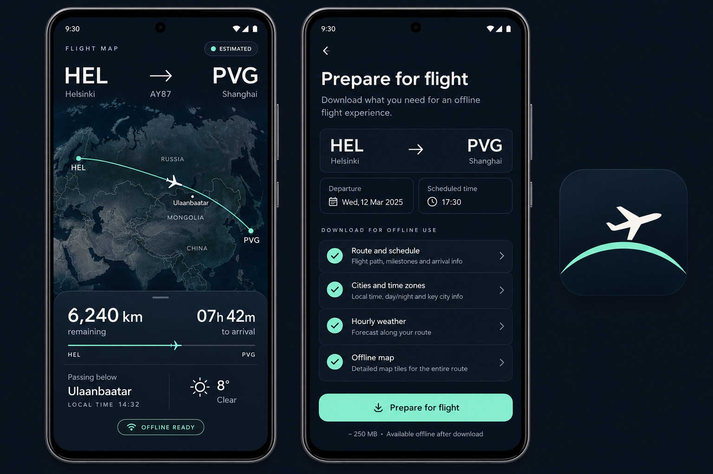

# Flight Map

A native Android window-seat companion. Enter a flight and ticket times, prepare on Wi-Fi, then explore an **estimated** journey offline. Kotlin, Jetpack Compose, Material 3 and MapLibre Native. Android 8.0+ (API 26).



## Use

1. Install the **release** APK from [Releases](https://github.com/alexeygrigorev/flight-map/releases) (signed; preferred). A debug APK may also be listed for development. Android may ask permission to install from the browser/files app.
2. Enter your **flight number** and **date** (e.g. `MU689` on `2026-10-20`, `CZ3382` on `2026-10-23`, `CZ3085` on `2026-10-25`, `EY801` on `2026-10-30`, `DE2553`/`EY1042` on `2026-10-31`, or `AY87` on `2026-10-20`) — or tap one of the quick trip chips. The app shows a **Confirmed Flight** card with origin/destination airports, local departure/arrival times, and the filed ATS route corridor.
3. Tap **Download data** once to preload the curated route cities (≤36 cities) and approximate/Open-Meteo weather. Once downloaded, the primary button switches to **Open offline flight** so you never accidentally re-download. An optional **Push reminder ~1h before departure** switch lets you refresh weather before boarding. If your saved flight was prepared with an earlier version (bundled overview only), tap **Download detailed route map** on the first screen (or in Saved flights & options) to add high-detail NASA imagery for deep zoom.
4. Alternatively, tap **Load .flightpack.json** to import a single-flight pack, a multi-flight trip pack (`flight-map-multipack`), or a demo-now pack (`demoStartsNow: true`) without typing, or tap **Simulate flight** to immediately test the flight in 60× simulation mode.
5. In the 3D globe view:
   - Pinch to zoom (up to 12×), drag to pan, twist with two fingers to rotate, drag vertically with two fingers to tilt, or double-tap to zoom into a point. Tap **Portrait / Landscape** in the top-right header to switch between horizontal landscape and vertical portrait orientations.
   - Tap **Play / Sim** (or `▶ Takeoff Play`) at takeoff to anchor the flight clock to your press time, scrub forward/back along the route, toggle `1× Live` / `60× Sim`, or tap **Return to now** at any time to snap back to the current live clock position.
   - Tap any city on the 3D globe (or **City card** in the bottom dock) to inspect a concise structured **Wikidata-style card** (description, population, local time, weather, wing direction/distance, and cultural/geographic fact) with `◀ Prev` / `Next ▶` navigation along the corridor.

The position moves at constant elapsed fraction of **scheduled block time** (or takeoff-anchored play clock) along the filed route corridor.

## Offline contents

- Route and schedule; 4,568 bundled medium/large IATA airports and 69,822 places with time zones.
- Curated corridor cities (up to 36 stratified highlights along the route) with structured Wikidata-style descriptions, facts, IANA time zones, and populations.
- Single-batch Open-Meteo hourly forecast for up to 24 corridor cities with instant offline solar/seasonal approximate fallback so preparation completes in seconds.
- Bundled NASA Blue Marble 3D satellite globe with anti-aliased horizon limb and Natural Earth country borders locked 1:1 to the sphere projection. Deep-zoom detail is cached NASA GIBS imagery rendered on the globe; downloaded MapLibre vector corridor regions are cached offline alongside the pack but are not drawn on the 3D globe.

## Build and test

JDK 21, Android SDK platform 35/build tools 35, and network for initial Gradle dependency resolution:

```sh
export ANDROID_HOME=/path/to/Android/Sdk
./gradlew :core:test :app:assembleDebug :app:lintDebug
# app/build/outputs/apk/debug/app-debug.apk
```

### Release signing

Release builds are signed with a keystore that lives **outside** the repo. Never commit the keystore or passwords.

1. Create a PKCS12 keystore (once), e.g. `~/.flight-map/keys/flight-map-release.keystore`.
2. Put a gitignored `keystore.properties` at the repo root (also keep a copy under `~/.flight-map/`):

```properties
storeFile=/home/YOU/.flight-map/keys/flight-map-release.keystore
storePassword=...
keyAlias=flight-map-release
keyPassword=...
```

`storeFile` may be absolute or relative to the repo root. For PKCS12, `storePassword` and `keyPassword` must match.

3. Build the signed release APK:

```sh
./gradlew :app:assembleRelease
# app/build/outputs/apk/release/app-release.apk
```

Without `keystore.properties` (or all four `ANDROID_RELEASE_*` env vars for CI), `assembleRelease` / `packageRelease` fails closed instead of producing an unsigned APK. On the Hetzner build host the keystore is at `~/.flight-map/keys/flight-map-release.keystore` with properties at `~/.flight-map/keystore.properties` (symlink or copy into the worktree as `keystore.properties`).

`core` is plain Kotlin/JVM: spherical distance/interpolation/bearing, bounded corridor selection, scheduled timing and strict weather parsing. JUnit tests cover poles, antipodes, date-line crossings, pre-/post-flight timing, invalid schedules and malformed forecasts.

`app` contains Compose UI, a ViewModel, atomic JSON multi-pack and preparation-checkpoint persistence, foreground-service preparation, batched weather downloads, native offline region creation/verification and a lifecycle-aware MapView. No GPS/location permissions, accounts, analytics or API keys. Preparation sends city coordinates to Open-Meteo and tile requests to OpenFreeMap; no calls to those services are initiated by the in-flight UI.

Dataset validation and regeneration:

```sh
python3 tools/update_data.py --verify-only
python3 tools/update_data.py  # refresh public source datasets
```

A smoke script exercises a **dedicated** emulator, prepares the default HEL–PVG example, disables connectivity, cold-restarts, checks the restored pack and captures screenshots:

```sh
python3 tools/emulator_smoke.py --serial emulator-5580 --shots /tmp/flight-map-shots
```

It changes connectivity on that emulator; use an isolated AVD. It requires ADB and Python 3, and the app already installed. Unit tests require no emulator/network once dependencies are cached.

## Sources and next steps

[Attribution, licenses and service policies](docs/DATA-SOURCES.md). [Generated design assets](docs/design/README.md).

The fallback timetable is advisory, not a date-verified booking. Next: exact time-zone boundaries for airports near borders, accessibility/font-scale testing on physical devices. Release APKs are signed for sideload evaluation; this is not yet a Play Store release. Builds run locally on Hetzner; no GitHub Actions required.

Additional v0.2 offline UI smoke (dedicated emulator only):

```sh
python3 tools/emulator_v02_smoke.py --serial emulator-5582 --shots /tmp/flight-map-v02-shots --offline-open
```

Android may suppress notifications if permission is denied; preparation still runs in the foreground-service task manager. Android force-stop intentionally prevents automatic service restart: reopen the app and tap **Resume preparation**. Reboot recovery follows Android background-service restrictions; a saved checkpoint remains available for resume.

Recovery and multi-pack verification (destructive to the dedicated emulator's Flight Map test data):

```sh
python3 tools/emulator_v02_recovery.py --serial emulator-5582 --shots /tmp/flight-map-v02-shots --evidence /tmp/flight-map-v02-validation
python3 tools/emulator_v02_packs.py --serial emulator-5582 --shots /tmp/flight-map-v02-shots --evidence /tmp/flight-map-v02-validation
```

The recovery check sends preparation to Home, kills the process, checks sticky foreground-service restart, pauses, reboots the dedicated emulator, and resumes the same native region IDs. The pack check prepares a second route, restores both in airplane mode, deletes the newest pack, and verifies only its native regions were removed.
